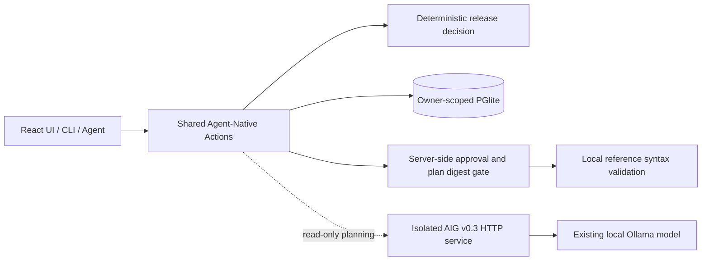

# Release Decision Workbench

A small release review application built on Agent-Native. It accepts explicit CI facts, creates a deterministic release proposal, stores an owner-scoped audit trail, and requires a persisted approval before a bounded local reference-validation action can run.

This is a Phase 0 technical spike for the [Builder.io Agent-Native Hackathon 2026](https://www.builder.io/hackathon). The published deadline is **November 3, 2026 at 20:59 NZDT** (November 2 at 11:59 PM Pacific Time); see the [official rules](https://www.builder.io/hackathon/rules). The work is not a production deployment tool.

## Architecture

- Agent-Native **0.220.0** provides the chat template, shared Action runtime, authentication context, React hooks, local development server, and database lifecycle.
- `analyze-release` contains the single deterministic CI decision implementation used by the React page, Agent-Native CLI, and agent tool catalog. It does not ask an LLM to infer facts.
- Drizzle and local PGlite store proposals and audit events. Every query is scoped to the signed-in owner. Local CLI analysis uses a single documented local-only owner and cannot approve, reject, or execute.
- A narrow TypeScript HTTP adapter may call the separate AIG v0.3.0 service at `POST /api/plans`. It permits a loopback origin only, caps request/response sizes and time, validates the full response, and accepts one read-only `get_service_record/1` step for `service-demo`.
- Approval stores a SHA-256 digest of the exact deterministic plan. Server-side transition checks and `authorize` independently block unapproved, rejected, changed, duplicate, CLI, and raw HTTP execution attempts.
- The only execution effect is local validation of the submitted reference syntax. It does not fetch CI evidence, deploy, or contact production systems.



## Local development

Requirements: Node.js **22.22 or newer** and pnpm **10.29.1**. This checkout was installed with `npx --yes pnpm@10.29.1 install`.

```powershell
Copy-Item .env.example .env
npx --yes pnpm@10.29.1 install --frozen-lockfile
npx --yes pnpm@10.29.1 dev
```

The development server prints its actual URL. The default `DATABASE_URL=pglite:./data/pglite` stores local database files under ignored `data/`; no cloud database is used. The app's local development authentication creates a throwaway developer identity. For standalone production, use the framework's supported authentication and persistent PostgreSQL setup; keep AIG private and separate.

The generated Agent-Native CLI is included, but a successful workbench Action invocation through the CLI is not yet verified on this Windows checkout. The default `hello` Action emitted its result before the process exited with a libuv assertion, and the release action's positional JSON failed parsing. See the [Phase 0 test report](docs/PHASE0-TEST-REPORT.md).

For AIG planning, set `AIG_API_BASE_URL` to an isolated local AIG instance. The sample `.env.example` points to `http://127.0.0.1:8787`; never point this demo to a persistent personal AIG database. The action submits intent only and does not execute AIG plans.

## Checks

```powershell
npx --yes pnpm@10.29.1 typecheck
npx --yes pnpm@10.29.1 agent-native:doctor
npx --yes pnpm@10.29.1 test
```

See [Phase 0 test report](docs/PHASE0-TEST-REPORT.md) for actual counts, the isolated AIG result, browser status, and the local-model Tool Calling result.

## Security and scope limits

- CI facts and evidence references are user-supplied strings; they are not verified against a CI provider.
- PGlite is local development storage. This spike has not been deployed or reviewed for production hosting.
- The CLI has one shared local data owner for safe analyze/list/plan calls. Approval and execution require the authenticated workbench or a framework-approved agent tool call. Direct CLI and raw HTTP requests are denied by the server-side guard.
- Approval binds the saved plan digest and owner. The bounded final action only validates reference shape and records the result; it does not establish that referenced evidence exists.
- AIG is constrained to a single read-only service inspection plan. AIG's other actions, durable execution path, database, authentication, and state remain in the separate AIG repository.
- The installed local model generated a valid AIG plan in one integration call. Its Agent-Native Action Tool Calling did not pass the real-model check; no paid provider was used.

## Work disclosure

### PRE_EXISTING_AIG_WORK

The separate `agentic-intent-gate` project predates this competition work. Its stable baseline is v0.2.0; the audited planning source is AIG v0.3.0 commit `bb8e8fb1234128613a750bee17967b225072bb14`. Its planning API, schemas, validation, providers, and execution controls are credited and left in that repository. No AIG source or history was copied or modified.

### HACKATHON_NEW_WORK

Created in this repository during the competition period: the Agent-Native 0.220.0 scaffold, Release Decision Workbench UI, deterministic CI decision Action, Drizzle/PGlite proposal and audit schema, digest-bound server-side approval and local execution gate, strict AIG TypeScript adapter, tests, and Phase 0 evidence documents. The framework scaffold and pre-existing AIG are disclosed rather than represented as newly authored work.

## Phase 0 status

The final acceptance record is [here](docs/PHASE0-FINAL-ACCEPTANCE.md). Phase 0 is intentionally distinct from Phase 1. Do not treat this spike as production-ready release automation.
