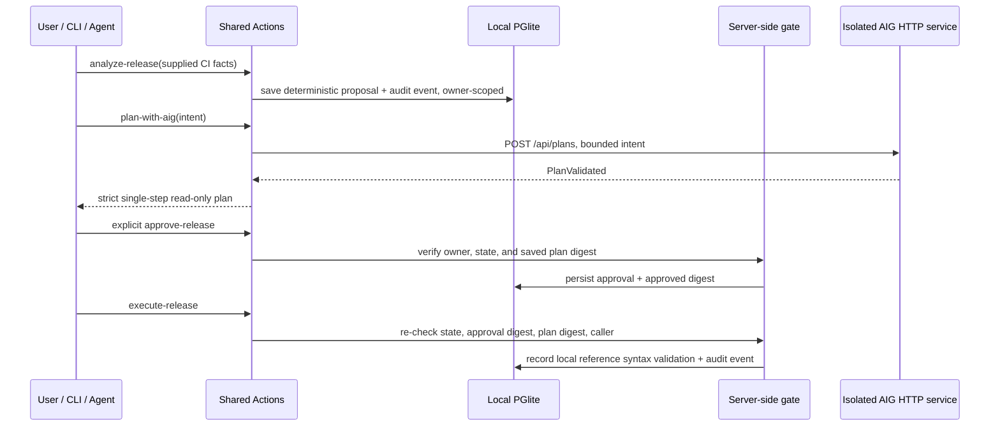

# Phase 0 Architecture Decision

Status: accepted for the Phase 0 spike. This decision does not authorize Phase 1.

## Decision

Use the official Agent-Native Chat scaffold at version **0.220.0** and retain AIG as a separate Python planning service. Implement deterministic release evaluation, proposal persistence, approval state, and the minimal local action in new TypeScript Actions backed by local PGlite. Use the AIG v0.3.0 HTTP contract only for a narrow, read-only planning preview.

The integration was verified against an AIG process started at `127.0.0.1:8787` with `AIG_DB_PATH` under `%TEMP%`; a real `POST /api/plans` call using local `phi4-mini:latest` returned `PlanValidated`. The new adapter additionally validates all wire data and restricts accepted plans to one `get_service_record/1` step for `service-demo`, `risk_class=READ_ONLY`.

## Options

| Option | Time | Operational complexity | Reproducibility / testability | Model need | Security and demo reliability | Framework / originality |
|---|---|---|---|---|---|---|
| **A. HTTP reuse (selected)** | Low | Two local processes | Strong contract tests plus a live isolated call; same endpoint as AIG | Uses the existing local Ollama model for planning | Good for a technical spike; fail-closed timeout/errors and loopback-only service; model latency remains | Agent-Native owns the new release workflow; AIG is attributed and separate |
| B. Selective TypeScript port | Medium/high | One process | Could be deterministic but would duplicate Python validation/provider behavior | Depends on port scope | Risk of contract drift and unverified assumptions | More code would be new, but AIG behavior attribution and parity costs rise |
| C. Independent Agent-Native implementation | Medium | One process | Easiest to run and test locally | No model required for deterministic release decisions | Most reliable deterministic demo; no AIG planning integration | Agent-Native compliance remains, but loses demonstrated AIG reuse |

Option A is the lowest-risk way to prove both the existing contract and the new framework integration, because source inspection, current AIG tests, and an isolated real request all support it. AIG does not own the release decision or approval logic.

## Trust and data boundaries

The final local action does not fetch or authenticate external evidence. `needsApproval` is present for the intended human flow, and `authorize` plus durable state/digest checks enforce the boundary independently. Direct CLI/raw HTTP mutation calls are denied. Local CLI analyze/list/plan use one synthetic local owner; no production data or multi-user CLI identity is implied.

## Not in this decision

No production deployment, live CI-provider integration, paid model provider, cloud database, actual deployment, AIG action execution, or Phase 1 feature work is included.
